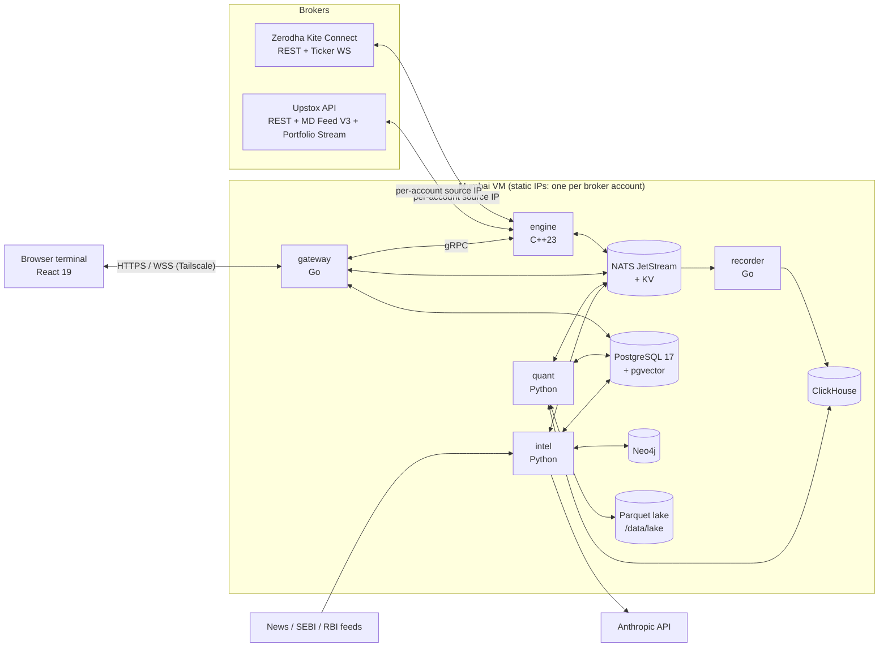
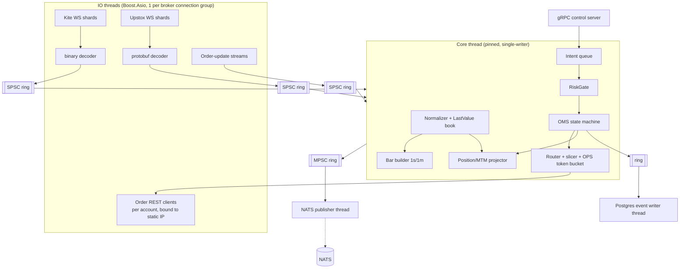

# Architecture

## 1. Design principles
1. **Hot path in C++, everything else where it's most productive.** Market data and order handling run in C++. Fan-out and auth run in Go. Quant and AI run in Python. The UI is TypeScript. This mirrors Bloomberg: a C++ backend, plus a Chromium/JS front end on their R+ runtime.
2. **One risk gate, one OMS, one strategy API.** Backtest, paper and live share the same C++ core (`vyuha_core`). Only the clock and the broker adapter change.
3. **Event-sourced trading state.** Orders, fills and limit changes are events. Positions and P&L are projections. Restart = replay + broker reconcile.
4. **Contracts first.** Protobuf (`proto/`) for streams and gRPC, OpenAPI for REST.
5. **Single-VM first.** ≤ 10 users fit on one Mumbai VM. Every service is stateless except the databases, so splitting out later is mechanical.

## 2. System context



## 3. Services

| Service | Lang | Responsibilities | State |
|---|---|---|---|
| `engine` | C++23 | Broker sessions (MD + orders), normalizer, bar builder, OMS, **RiskGate**, kill switch, SimBroker, reconciliation, publishes ticks/orders/positions to NATS, gRPC control API | In-memory, rebuilt from Postgres `order_event` + broker reconcile; writes order events to Postgres via a dedicated writer thread |
| `gateway` | Go | Auth/MFA/JWT, RBAC, REST API, WebSocket fan-out with per-client conflation, entitlement filtering, audit writer, broker OAuth callbacks, admin | Stateless (Postgres) |
| `recorder` | Go (same module) | NATS `md.>` → ClickHouse batch inserts (ticks, bars) | Stateless |
| `quant` | Python | Risk analytics (Greeks, VaR, scenarios, factors), option-chain analytics, data download jobs, backtest workers, strategy host (paper/live strategies), cost model | Stateless workers; jobs via NATS JetStream work-queue |
| `intel` | Python | Feed ingestion, LLM extraction, entity resolution, Neo4j writes, context mapping + alerts, copilot orchestration, MCP server, daily briefs | Stateless |
| `web` | TS | Terminal UI | Browser |

## 4. Engine internals



**Threading model.** A single-writer core thread owns all mutable trading state: books, positions, the OMS and limits. IO threads only decode and enqueue. This removes locks from the hot path and makes behaviour deterministic. Backtest mode runs the same core loop driven by a simulated clock in the caller's thread.

**Memory.** Pre-allocated pools for `Tick`, `Order` and `Intent`. No heap allocation per tick on the core thread (asserted in debug builds with a counting allocator).

**Key interfaces (C++).**
```cpp
namespace vyuha::broker {
struct SessionConfig { AccountId account; BrokerKind kind; std::string api_key;
                       SecretRef api_secret; std::string access_token; IpAddr source_ip;
                       std::optional<IpAddr> backup_ip; RateLimits limits; };
class IBrokerAdapter {
 public:
  virtual ~IBrokerAdapter() = default;
  virtual std::expected<void, Error> start(const SessionConfig&) = 0;   // binds sockets to source_ip
  virtual std::expected<BrokerOrderId, Error> place(const risk::ApprovedOrder&) = 0;
  virtual std::expected<void, Error> modify(const risk::ApprovedModify&) = 0;
  virtual std::expected<void, Error> cancel(const BrokerOrderId&) = 0;
  virtual std::expected<std::vector<BrokerOrder>, Error> order_book() = 0;
  virtual std::expected<std::vector<BrokerPosition>, Error> positions() = 0;
  virtual std::expected<Margins, Error> margins() = 0;
  virtual void on_order_update(std::function<void(const OrderUpdate&)>) = 0;
};
class IMarketDataSource {
 public:
  virtual ~IMarketDataSource() = default;
  virtual std::expected<void, Error> subscribe(std::span<const InstrumentId>, FeedMode) = 0;
  virtual std::expected<void, Error> unsubscribe(std::span<const InstrumentId>) = 0;
  virtual void on_tick(std::function<void(const Tick&)>) = 0;     // called on IO thread → ring
};
}  // namespace vyuha::broker

namespace vyuha::risk {
class ApprovedOrder {            // only RiskGate can construct
  friend class RiskGate;
  explicit ApprovedOrder(const OrderIntent&, GateStamp) noexcept;
 public:
  const OrderIntent& intent() const noexcept;
  const GateStamp& stamp() const noexcept;   // rule-set version, eval ns, gate id
};
}
```

## 5. Static IP binding (per account)
- The VM has N public static IPs: AWS Elastic IPs on secondary private IPs of one ENI, or the equivalent on GCP/Azure. Each is configured on the host interface (see `deploy/netplan-static-ips.example.yaml`).
- `broker_account.static_ip` holds the **private** address mapped to that public IP. A `public_ip` column is kept for display and for verifying the broker registration.
- Adapters bind every outbound socket (REST via Beast `socket.bind()` before connect, WS likewise) to `source_ip`.
- Preflight at session start: (1) the IP exists on a host interface; (2) optional echo check through a configured `IP_ECHO_URL` confirms that the egress public IP equals the registered one. On failure → `STATIC_IP_NOT_ON_HOST` / `STATIC_IP_EGRESS_MISMATCH`, and the session stays down.
- Reason: NSE's rules allow one primary (+ one backup) static IP per client, shareable only among family members. Accounts of unrelated traders must not share an egress IP.

## 6. Data flows

### 6.1 Tick path
Broker WS → IO decode → SPSC ring → core normalize (canonical `Tick`, int64 prices) → update LastValue + bars + MTM → MPSC ring → NATS `md.tick.<exch>.<instrument_id>` (protobuf) and NATS KV `md_last` (latest snapshot) → gateway subscribes (only instruments some client wants, filtered by entitlement: each tick carries the `feed_id` of the session that received it, and goes only to users entitled through that account — ADR-020) → per-client conflation (default 250 ms) → WS protobuf frame → Web Worker decode → Zustand store → React (rAF-batched).
Recorder subscribes `md.>` → batches of 10k rows or 1 s → ClickHouse.

### 6.2 Order path
UI ticket → `POST /orders` (gateway: authN, RBAC, account mapping, idempotency) → gRPC `Engine.SubmitIntent` → intent queue → **RiskGate** → OMS `APPROVED` (durable in Postgres before anything is sent, ADR-025; the router polls the writer, so Postgres stays off the core thread) → slicer/router → OPS token bucket → adapter REST → broker, with `client_order_id` in the broker tag. Broker ack/updates → order-update stream/postback → ring → OMS transition → NATS `oms.order.<account>` + Postgres `order_event` → gateway → WS → blotter.
Strategy path: strategy host (quant) → NATS request `engine.intent` (same gRPC message) → same gate.
AI path: copilot `draft_order_ticket` → WS message `ui.open_ticket` → human presses Ctrl+Enter → normal UI path.

### 6.3 Risk analytics path
quant `risk-worker` subscribes `oms.position.>` and `md_last` KV every 1 s → computes Greeks/exposures per scope → NATS `risk.summary.<scope>` + ClickHouse `risk_metrics`. Every 5 s (desk) → VaR/scenarios. Nightly → factor model rebuild. Post-trade breach detection (e.g. MTM loss) → gRPC `Engine.SetKill` when configured.
The pre-trade gate uses **engine-local** state: positions, MTM, limits, and a margin cache refreshed every 10 s and after fills. It never synchronously calls Python.

### 6.4 Context path
Feeds → intel `ingest` (poll 60 s) → dedupe/cluster → `extract` (fast LLM) → `resolve` → Neo4j upsert → `context` traversal against `HOLDS` edges (synced from `oms.position.>`) → `context_alert` rows + NATS `ctx.alert.<user>` → gateway → WS toast + `N`/`CTX` panels.

## 7. NATS subjects & streams
| Subject | Payload (proto) | Stream / retention |
|---|---|---|
| `md.tick.<exch>.<iid>` | `marketdata.v1.Tick` | `MD` stream, memory, 15 min |
| `md.bar.<interval>.<iid>` | `marketdata.v1.Bar` | `BARS`, file, 2 days |
| KV `md_last` key `<iid>` | `marketdata.v1.Snapshot` | KV, history 1 |
| `engine.intent` (req/reply) | `orders.v1.OrderIntent` → `orders.v1.IntentResult` | — |
| `oms.order.<account>` | `orders.v1.OrderUpdate` | `OMS`, file, 7 days |
| `oms.fill.<account>` | `orders.v1.Fill` | `OMS` |
| `oms.position.<account>` | `orders.v1.PositionUpdate` | `OMS` |
| `risk.summary.<scope>.<id>` | `risk.v1.RiskSummary` | memory |
| `risk.kill` | `risk.v1.KillSwitchState` | `RISK`, file |
| `ctx.alert.<user>` | JSON `ContextAlert` | `CTX`, file, 30 days |
| `jobs.data`, `jobs.backtest` | JSON job | work-queue streams |
| `sys.health.<service>` | `common.v1.Health` | memory |

## 8. Failure handling
| Failure | Behaviour |
|---|---|
| Broker WS drop | Exponential backoff + resubscribe; status bar red; gap logged; MTM marks stale after 3 s (UI dims) |
| Broker REST timeout on place | Order → `UNKNOWN`; reconcile via order book within 2 s; **never auto-resend** |
| Broker token expired (daily) | Session → `awaiting_login`; trading blocked for that account; UI prompts login |
| Engine crash | systemd/compose restart → load open orders + fills from Postgres → reconcile all accounts → resume; resting broker stops protect brackets |
| Postgres down | Engine keeps market data, fills and cancels going in memory with a bounded event ring. No new order is sent while events aren't durable, including position-reducing and flatten orders (ADR-025, owner 2026-11-03); the broker's own terminal is the fallback for flattening. If ring > 80% → auto kill-switch "block new" (desk) until DB recovers |
| NATS down | Engine continues trading; UI stale; gateway serves REST from Postgres; alert |
| quant/intel down | Trading unaffected (gate is engine-local); risk analytics panels show stale marker |
| Clock skew | chrony required; engine refuses start if skew > 250 ms vs NTP |

## 9. Deployment topology (MVP)
- One VM: 8 vCPU, 32 GB RAM, 500 GB NVMe, Ubuntu 24.04 LTS, Mumbai region, N static public IPs.
- `docker compose` (`deploy/staging/`, runbook `docs/STAGING.md`, ADR-022): Postgres, NATS and ClickHouse on a bridge network with ports on 127.0.0.1 only; engine, gateway, recorder, quant and Caddy with `network_mode: host`, so the engine binds account IPs and internal hops (engine gRPC, quant API) stay on loopback until mTLS. Scheduled jobs are host systemd timers.
- Caddy terminates TLS for `gateway`. Access via Tailscale (recommended), or an IP allowlist.
- Backups: nightly `pg_dump` + ClickHouse `BACKUP` + Neo4j dump + lake rsync → off-box storage, 30-day retention; restore drill each milestone from M3.
- Observability: OTel SDKs in all services → Prometheus (metrics), Loki (logs), Grafana dashboards: engine latency histograms, risk gate rejects by code, OPS per account, WS clients, LLM tokens/cost.

## 10. Latency budget (internal, excluding broker)
| Hop | Budget p99 |
|---|---|
| WS frame decode → ring | 30 µs |
| Normalize + book + MTM | 50 µs |
| NATS publish | 100 µs |
| Gateway conflation window | 250 ms (configurable 50–1000) |
| Browser decode + paint | 50 ms |
| Intent gRPC → gate → REST write | 1 ms |

Retail broker REST/WS round-trips are typically tens of milliseconds and outside our control. The C++ core exists for determinism, throughput across many instruments and accounts, shared backtest/live code, and a path to direct exchange connectivity later. It is not for HFT on retail APIs. Keep this honest in docs and UI.
